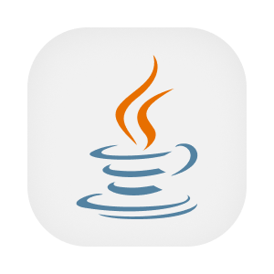
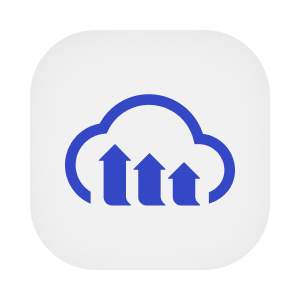

  

  
  
  
  
  
  
  
  

# Cadastro central da plataforma

Este serviço reúne os cadastros que sustentam a operação de energia solar. Pessoas e empresas usam esses dados para encontrar profissionais e produtos, cadastrar unidades consumidoras e faturas, negociar propostas e acompanhar projetos, contratos e serviços técnicos. O mesmo domínio mantém carrinho, pedidos, vendas, planos, assinaturas e cobranças. O acesso aos recursos depende da identidade, do cargo e da participação da pessoa na operação.

Os aplicativos e os outros serviços consultam esse cadastro por HTTP. O JWT emitido pelo serviço de acesso identifica a pessoa, e chaves próprias identificam os consumidores internos. PostgreSQL guarda os dados de negócio, Redis mantém o cache de buscas e Cloudinary armazena parte dos arquivos. Integrações atendem tradução, recomendação, validação profissional e envio de convites, com limites específicos para cada uma.

## Aprofunde-se no Projeto!

- [OVERVIEW.md](./docs/OVERVIEW.md), capacidades e regras do produto.
- [ARCHITECTURE.md](./docs/ARCHITECTURE.md), módulos, segurança, integrações e decisões técnicas.
- [RUNNING.md](./docs/RUNNING.md), dependências, configuração e testes locais.
- [API.md](./docs/API.md), contrato, autenticação, grupos de rotas e exemplos.
- [DEPLOY.md](./docs/DEPLOY.md), ambientes e publicação.
- [STATUS.md](./docs/STATUS.md), limitações e divergências verificadas.
- [Fluxos](./flows/), negociação, execução, aprovação profissional, convites, arquivos e traduções.
- [Banco de dados](./database/), schema PostgreSQL e cache Redis.
- [PENDENCIAS.md](./PENDENCIAS.md), diferenças e decisões que dependem do responsável.

## Contribuindo

- [CONTRIBUTING.md](https://github.com/Solierrr/.github/blob/main/.github/CONTRIBUTING.md), convenções de commit, branch e Pull Request.
- [CODE_OF_CONDUCT.md](https://github.com/Solierrr/.github/blob/main/CODE_OF_CONDUCT.md), código de conduta.
- [SECURITY.md](https://github.com/Solierrr/.github/blob/main/SECURITY.md), como reportar uma vulnerabilidade.
