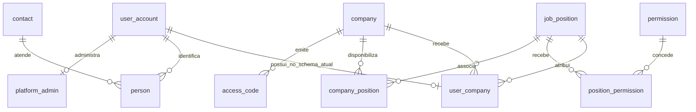
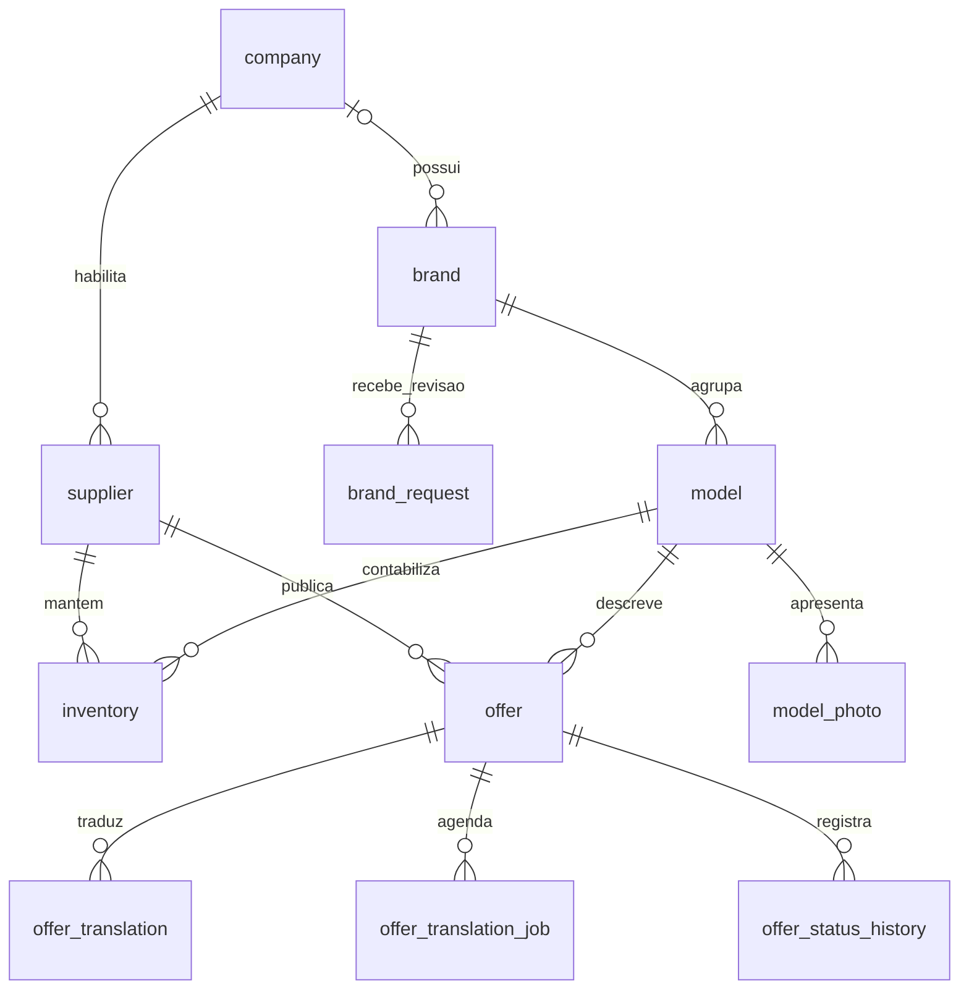
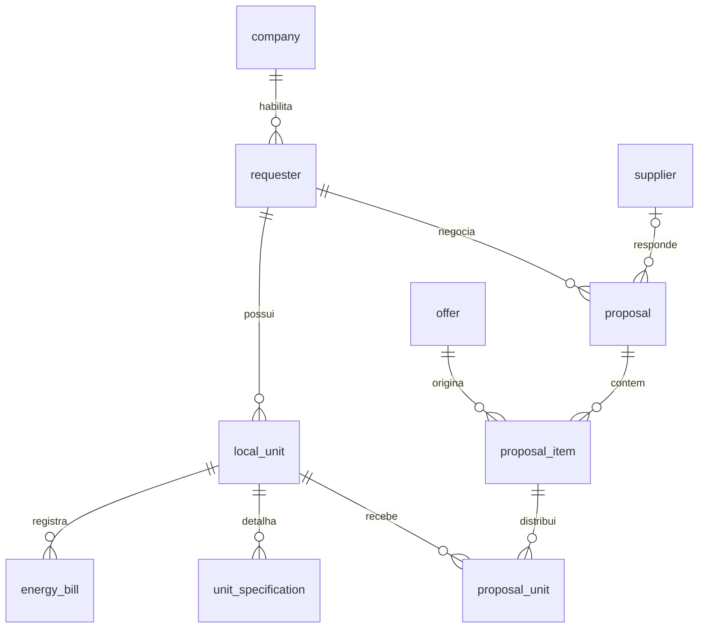
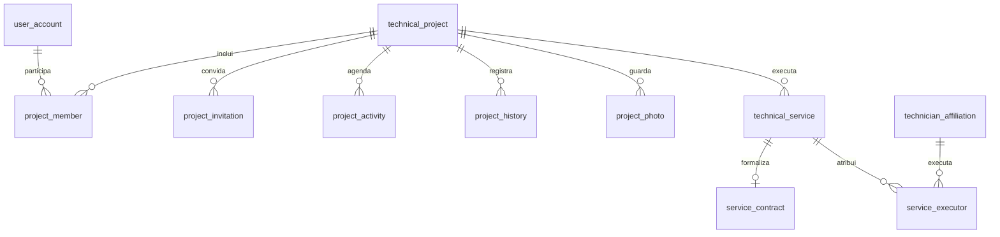
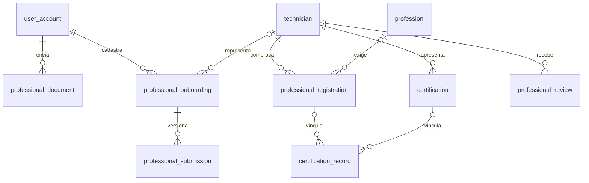
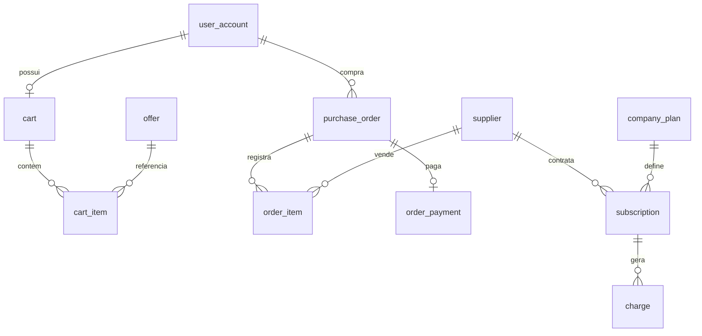

  

# PostgreSQL de negócio

O serviço é dono do DDL do `coredb` na main analisada. Flyway aplica as migrations de `src/main/resources/db/migration/`, e Hibernate valida o resultado. A conexão é montada com as variáveis `DB_POSTGRES_*`. Este documento usa o schema real do serviço, sem tomar os diagramas antigos como fonte.

## Fonte e adoção

[V1__baseline.sql](https://github.com/Solierrr/api-core/blob/main/src/main/resources/db/migration/V1__baseline.sql) contém 68 tabelas, chaves, índices, triggers e a procedure de cobrança. [V2__export_views.sql](https://github.com/Solierrr/api-core/blob/main/src/main/resources/db/migration/V2__export_views.sql) cria as views de exportação. [V3__reference_data.sql](https://github.com/Solierrr/api-core/blob/main/src/main/resources/db/migration/V3__reference_data.sql) adiciona permissões, cargo administrativo e plano de referência.

O baseline tem nomes como `user_account`, `job_position` e `company_plan`, diferentes dos usados pelos consumidores do schema anterior, e a aplicação desativa o baseline automático para banco não vazio. Os consumidores, como a carga de dados e o grafo, acompanham o schema atual do `api-core`.

Todas as tabelas do baseline têm chave primária `id` em UUID e campos de criação e atualização. A metadata `flyway_schema_history` é administrada pelo Flyway e não é uma entidade de negócio. Os diagramas abaixo mostram recortes das relações. O DDL vinculado é a referência para todos os campos e ações de foreign key.

## Identidade e empresa

`auth_id` e `username` são únicos em `user_account`. O username segue formato de letras minúsculas, números e sublinhado. `uq_user_company_user` permite somente um vínculo por pessoa, divergindo da decisão de produto de vários vínculos com cargos diferentes.

`company.type` aceita fornecedor ou solicitante. A propriedade de um projeto técnico admite empresa ou pessoa, exatamente um dos dois. Endereços podem pertencer a empresa, com foreign key diferível para permitir a criação de relações dentro da transação.

## Catálogo e estoque

O `inventory` é único por fornecedor e modelo, e a oferta exige preço positivo e disponibilidade não negativa, com uma tradução única por oferta e idioma. O job de tradução é único por oferta e versão do texto de origem, e a fila tem um índice parcial para os trabalhos disponíveis e para o token de claim.

As marcas privadas ativas são únicas por empresa e nome normalizado, as marcas públicas têm nome único e a solicitação pendente de marca também tem um índice único parcial. Os modelos separam os campos de placa e de infraestrutura por constraints, e as fotos de modelo e de unidade têm no máximo uma foto principal, garantida pelo índice parcial correspondente.

## Propostas e unidades

As quantidades de item e de alocação precisam ser positivas, e a proposta guarda o estado, as partes e o total, com o aceite reservando estoque nos serviços da aplicação. O schema não tem uma relação entre proposta e projeto técnico que represente uma conversão automática.

## Projetos e execução

A participação é única por projeto e pessoa, e as fotos de projeto ficam em `bytea`, com constraint de até 8 MiB e tipo JPEG ou PNG, num índice que permite uma única foto principal e numa quantidade limitada pelo serviço. Cada serviço técnico tem no máximo um contrato, e as atividades têm o período validado e um vínculo único opcional com o serviço.

## Aprovação profissional

Onboarding é único por `auth_id`. Submissão é única por onboarding e revisão. O documento admite bytes no banco ou referência autenticada no Cloudinary, com exclusividade entre os dois formatos. Submissões guardam snapshot e política como texto JSON, sem transformar o rascunho automaticamente em perfil aprovado.

A avaliação é única por avaliador, técnico e serviço, com nota de zero a cinco. Equipes possuem técnico responsável e integrantes únicos por equipe. A afiliação independente ativa tem índice único parcial por técnico.

## Pedidos e assinatura

O pedido guarda um retrato dos preços, dos descontos e dos totais, com um pagamento único por pedido, e excluir a oferta pode anular a referência no item histórico sem perder esse retrato. Os itens do carrinho e do pedido têm quantidade positiva, e os totais, o preço líquido e a situação de reembolso têm constraints.

As triggers impedem compras da própria empresa e aplicam elegibilidade de comprador. Outra trigger impede que conta gerenciada por uma empresa seja vinculada a outra. `generate_subscription_charge` bloqueia a assinatura, não repete a cobrança do mesmo vencimento e exige preço positivo do plano.

## Inventário de tabelas

Cada linha descreve uma tabela do baseline, e os índices declarados por `CREATE INDEX` estão na tabela seguinte, lembrando que as chaves primárias e as constraints únicas também criam índices no PostgreSQL.

| Tabela | Responsabilidade | Unicidade declarada além da chave primária |
|---|---|---|
| `access_code` | códigos de acesso a empresa e cargo, com validade e estado | `code` |
| `address` | endereços e empresa proprietária quando aplicável | sem restrição UNIQUE adicional no bloco |
| `brand` | marcas privadas, públicas ou legadas e seu proprietário | sem restrição UNIQUE adicional no bloco |
| `brand_request` | solicitações de publicação ou correção de marca e decisão | sem restrição UNIQUE adicional no bloco |
| `business_contact` | contato comercial da empresa | sem restrição UNIQUE adicional no bloco |
| `cart` | carrinho único por pessoa | `user_id` |
| `cart_item` | quantidade de uma oferta no carrinho | `cart_id, offer_id` |
| `certification` | certificados do profissional e seus dados de apresentação | sem restrição UNIQUE adicional no bloco |
| `certification_record` | vínculo entre certificado e registro profissional | sem restrição UNIQUE adicional no bloco |
| `charge` | cobranças de uma assinatura, vencimento e pagamento | sem restrição UNIQUE adicional no bloco |
| `company` | empresa, tipo, estado de análise, endereço e contato | `slug` |
| `company_photo` | fotos de perfil e banner da empresa, com recorte | sem restrição UNIQUE adicional no bloco |
| `company_plan` | nome, preço e ciclo do plano | sem restrição UNIQUE adicional no bloco |
| `company_position` | cargos disponibilizados por empresa | sem restrição UNIQUE adicional no bloco |
| `contact` | contato pessoal de e-mail e telefone | sem restrição UNIQUE adicional no bloco |
| `energy_bill` | consumo, valor e referência de arquivo da fatura | sem restrição UNIQUE adicional no bloco |
| `flux_log` | registro de ações associado à pessoa | sem restrição UNIQUE adicional no bloco |
| `geolocation` | coordenadas associadas a endereço | sem restrição UNIQUE adicional no bloco |
| `inventory` | saldo de um modelo por fornecedor | `supplier_id, model_id` |
| `job_position` | cargo de acesso e descrição de acessos | `name` |
| `local_unit` | unidade do solicitante, endereço e tipo de local | sem restrição UNIQUE adicional no bloco |
| `local_unit_photo` | banner e galeria da unidade | sem restrição UNIQUE adicional no bloco |
| `model` | modelo de placa ou infraestrutura, marca e estado de análise | sem restrição UNIQUE adicional no bloco |
| `model_photo` | galeria do modelo, com foto principal | sem restrição UNIQUE adicional no bloco |
| `offer` | oferta, preço, disponibilidade e estados comercial e de tradução | `slug` |
| `offer_service_region` | regiões atendidas por uma oferta | sem restrição UNIQUE adicional no bloco |
| `offer_status_history` | mudanças de estado comercial e autoria | sem restrição UNIQUE adicional no bloco |
| `offer_translation` | texto de oferta por idioma | `offer_id, locale` |
| `offer_translation_job` | fila durável de tradução com tentativas e lease | `offer_id, source_offer_translation_id` |
| `order_item` | snapshot de produto, fornecedor, preço e quantidade do pedido | sem restrição UNIQUE adicional no bloco |
| `order_payment` | registro de pagamento e reembolso do pedido | `purchase_order_id` |
| `permission` | catálogo de permissões por operação | `permission_name` |
| `person` | identificação pessoal ligada à conta e ao contato | sem restrição UNIQUE adicional no bloco |
| `platform_admin` | contas com administração da plataforma | `user_id` |
| `position_permission` | permissões de cada cargo | sem restrição UNIQUE adicional no bloco |
| `profession` | profissão e requisitos de registro, NR10 e NR35 | sem restrição UNIQUE adicional no bloco |
| `professional_document` | evidências em bytes ou referência autenticada no Cloudinary | sem restrição UNIQUE adicional no bloco |
| `professional_onboarding` | rascunho, versão aprovada e suspensão por identidade | `auth_id` |
| `professional_registration` | registro em conselho por técnico e profissão | sem restrição UNIQUE adicional no bloco |
| `professional_review` | avaliação do técnico por serviço executado | `reviewer_user_id, technician_id, technical_service_id` |
| `professional_submission` | snapshot, política e decisão de uma revisão profissional | `professional_onboarding_id, revision` |
| `professional_team` | equipe empresarial e técnico responsável | sem restrição UNIQUE adicional no bloco |
| `professional_team_member` | integrantes técnicos da equipe | `professional_team_id, technician_id` |
| `project_activity` | agenda do projeto e serviço associado quando houver | sem restrição UNIQUE adicional no bloco |
| `project_history` | ações e autoria na linha do tempo do projeto | sem restrição UNIQUE adicional no bloco |
| `project_invitation` | convite, destinatário, papel e estado de envio de e-mail | sem restrição UNIQUE adicional no bloco |
| `project_member` | participação e papel da pessoa no projeto | `technical_project_id, user_id` |
| `project_photo` | conteúdo binário e metadados da galeria do projeto | sem restrição UNIQUE adicional no bloco |
| `proposal` | negociação entre solicitante e fornecedor | sem restrição UNIQUE adicional no bloco |
| `proposal_item` | oferta, preço negociado, desconto e quantidade proposta | sem restrição UNIQUE adicional no bloco |
| `proposal_unit` | distribuição da quantidade de um item por unidade | sem restrição UNIQUE adicional no bloco |
| `purchase_order` | pedido do comprador com totais e estado de cancelamento | sem restrição UNIQUE adicional no bloco |
| `requester` | papel de solicitante de uma empresa | sem restrição UNIQUE adicional no bloco |
| `service_contract` | contrato único do serviço técnico | `technical_service_id` |
| `service_executor` | executor do serviço por afiliação técnica | sem restrição UNIQUE adicional no bloco |
| `shift` | horário de disponibilidade do técnico | sem restrição UNIQUE adicional no bloco |
| `subscription` | plano contratado pelo fornecedor e situação da assinatura | sem restrição UNIQUE adicional no bloco |
| `supplier` | papel de fornecedor, situação e tipo de negócio | sem restrição UNIQUE adicional no bloco |
| `technical_company` | papel técnico associado a empresa | sem restrição UNIQUE adicional no bloco |
| `technical_course` | curso e informações mantidos por uma empresa | sem restrição UNIQUE adicional no bloco |
| `technical_project` | projeto de dono pessoal ou empresarial, localização e estado | sem restrição UNIQUE adicional no bloco |
| `technical_service` | serviço do projeto, agendamento, aceite e conclusão | sem restrição UNIQUE adicional no bloco |
| `technician` | profissional, estado de aprovação e identificação pública | `slug` |
| `technician_affiliation` | vínculo independente, afiliado ou parceiro do técnico | sem restrição UNIQUE adicional no bloco |
| `unit_specification` | especificações e referências da unidade consumidora | sem restrição UNIQUE adicional no bloco |
| `user_account` | identidade de negócio ligada ao auth_id e username | `auth_id`, `username` |
| `user_company` | vínculo empresarial e cargo da pessoa | `user_id` |
| `user_photo` | foto de perfil e banner pessoal, com recorte | sem restrição UNIQUE adicional no bloco |

## Índices explícitos

Os índices abaixo vêm diretamente do DDL do baseline. Predicados indicam índices parciais.

| Índice | Tabela | Tipo | Colunas e condição |
|---|---|---|---|
| `idx_access_code_company` | `access_code` | consulta | `(company_id)` |
| `idx_address_owner_company` | `address` | consulta | `(owner_company_id)` |
| `uq_brand_private_owner_company_name` | `brand` | único | `(owner_company_id, normalized_name) WHERE ((visibility = 'PRIVATE') AND (NOT is_archived))` |
| `uq_brand_public_name` | `brand` | único | `(normalized_name) WHERE (visibility = 'PUBLIC')` |
| `idx_brand_request_requester_company_created` | `brand_request` | consulta | `(requester_company_id, created_at DESC)` |
| `uq_brand_request_pending_brand` | `brand_request` | único | `(brand_id) WHERE (status = 'PENDING')` |
| `idx_charge_subscription` | `charge` | consulta | `(subscription_id)` |
| `idx_flux_log_user_created` | `flux_log` | consulta | `(user_id, created_at DESC)` |
| `idx_local_unit_requester` | `local_unit` | consulta | `(requester_id)` |
| `uq_local_unit_photo_banner` | `local_unit_photo` | único | `(local_unit_id) WHERE (type = 'BANNER')` |
| `uq_local_unit_photo_primary` | `local_unit_photo` | único | `(local_unit_id) WHERE is_primary` |
| `idx_model_product_type` | `model` | consulta | `(product_type)` |
| `idx_model_photo_model_created` | `model_photo` | consulta | `(model_id, created_at DESC)` |
| `uq_model_photo_primary` | `model_photo` | único | `(model_id) WHERE is_primary` |
| `idx_offer_model` | `offer` | consulta | `(model_id)` |
| `idx_offer_supplier` | `offer` | consulta | `(supplier_id)` |
| `idx_offer_service_region_offer` | `offer_service_region` | consulta | `(offer_id)` |
| `idx_offer_status_history_offer_created` | `offer_status_history` | consulta | `(offer_id, created_at DESC)` |
| `idx_offer_translation_job_available` | `offer_translation_job` | consulta | `(available_at, id) WHERE (status IN ('QUEUED', 'PROCESSING', 'RETRY_PENDING'))` |
| `idx_order_item_offer` | `order_item` | consulta | `(offer_id) WHERE (offer_id IS NOT NULL)` |
| `idx_order_item_purchase_order` | `order_item` | consulta | `(purchase_order_id)` |
| `idx_order_item_supplier_purchase_order` | `order_item` | consulta | `(supplier_id, purchase_order_id)` |
| `idx_professional_document_user` | `professional_document` | consulta | `(user_id)` |
| `idx_professional_registration_technician` | `professional_registration` | consulta | `(technician_id)` |
| `idx_professional_review_technician_created` | `professional_review` | consulta | `(technician_id, created_at DESC)` |
| `idx_professional_submission_work` | `professional_submission` | consulta | `(status, available_at)` |
| `idx_professional_team_company` | `professional_team` | consulta | `(company_id)` |
| `idx_professional_team_member_technician` | `professional_team_member` | consulta | `(technician_id)` |
| `idx_project_activity_agenda` | `project_activity` | consulta | `(technical_project_id, starts_at)` |
| `uq_project_activity_technical_service` | `project_activity` | único | `(technical_service_id) WHERE (technical_service_id IS NOT NULL)` |
| `idx_project_history_timeline` | `project_history` | consulta | `(technical_project_id, created_at DESC)` |
| `idx_project_invitation_recipient` | `project_invitation` | consulta | `(lower(email), status, expires_at)` |
| `idx_project_member_access` | `project_member` | consulta | `(user_id, technical_project_id) WHERE is_active` |
| `idx_project_photo_gallery` | `project_photo` | consulta | `(technical_project_id, created_at DESC)` |
| `uq_project_photo_primary` | `project_photo` | único | `(technical_project_id) WHERE is_primary` |
| `idx_proposal_requester` | `proposal` | consulta | `(requester_id)` |
| `idx_proposal_supplier` | `proposal` | consulta | `(supplier_id)` |
| `idx_proposal_item_offer` | `proposal_item` | consulta | `(offer_id)` |
| `idx_proposal_item_proposal` | `proposal_item` | consulta | `(proposal_id)` |
| `idx_purchase_order_buyer_user_created` | `purchase_order` | consulta | `(buyer_user_id, created_at DESC)` |
| `idx_requester_company` | `requester` | consulta | `(company_id)` |
| `idx_service_executor_technical_service` | `service_executor` | consulta | `(technical_service_id)` |
| `idx_shift_technician` | `shift` | consulta | `(technician_id)` |
| `idx_subscription_supplier` | `subscription` | consulta | `(supplier_id)` |
| `idx_supplier_company` | `supplier` | consulta | `(company_id)` |
| `idx_technical_project_owner_company` | `technical_project` | consulta | `(owner_company_id, created_at DESC)` |
| `idx_technical_project_owner_user` | `technical_project` | consulta | `(owner_user_id, created_at DESC)` |
| `idx_technical_project_requester` | `technical_project` | consulta | `(requester_id)` |
| `idx_technical_service_technical_project` | `technical_service` | consulta | `(technical_project_id)` |
| `idx_technician_person` | `technician` | consulta | `(person_id)` |
| `idx_technician_affiliation_technician` | `technician_affiliation` | consulta | `(technician_id)` |
| `uq_technician_affiliation_active_independent` | `technician_affiliation` | único | `(technician_id) WHERE (is_active AND (company_id IS NULL) AND (affiliation_type = 'INDEPENDENT'))` |
| `idx_user_company_company` | `user_company` | consulta | `(company_id)` |

## Exportação e consumidores

A aplicação escreve por serviços e repositories JPA. `api-auth` solicita provisionamento por HTTP e não é escritor direto do domínio neste contrato. O serviço de conversas consulta participação por rotas internas. Agentes operacionais usam as rotas com o JWT da pessoa.

As views do schema `export` são o contrato SQL de leitura para os consumidores em lote, e elas selecionam campos e excluem, em várias entidades, dados como documentos pessoais, conteúdo de arquivos e contatos. Essa seleção não equivale à anonimização de todas as views, e as permissões de leitura acompanham o escopo de cada consumidor.

O fluxo de análise está em [ANALYTICS_SYNC.md](https://github.com/Solierrr/docs-warehouse/blob/main/docs/flows/ANALYTICS_SYNC.md). Os nomes e as relações atuais devem ser usados ao atualizar rotinas de importação ou análise que ainda esperam o schema anterior. Backup e administração operacional do banco continuam ligados ao ambiente, descritos em [DEPLOY.md](../docs/DEPLOY.md).
