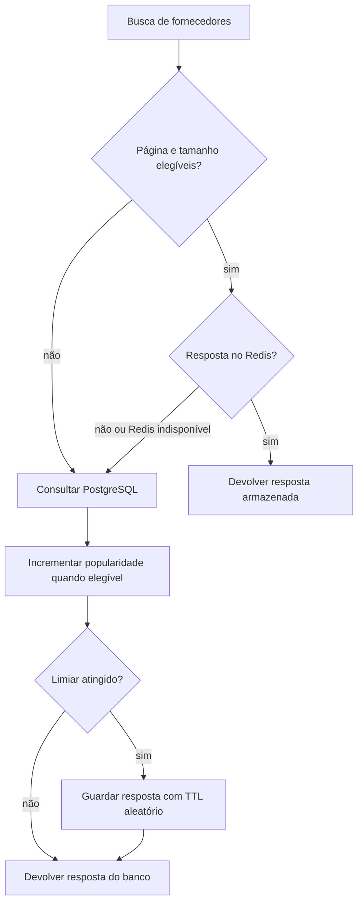

  

# Cache de fornecedores

Redis mantém respostas de buscas de fornecedores e contadores de popularidade. A fonte dos cadastros continua sendo o PostgreSQL. O serviço trata falhas de cache como ausência de resposta e continua pela consulta relacional.

## Chaves e conteúdo

[`CacheKeyGenerator`](https://github.com/Solierrr/api-core/blob/main/src/main/java/com/solaria/persistence/util/CacheKeyGenerator.java) normaliza texto, concatena campos com seus comprimentos e calcula SHA-256. A versão do formato é `v1` e o namespace configurado é `core`.

| Formato de chave | Conteúdo | Escopo |
|---|---|---|
| `core:v1:search:supplier:<sha256>` | `SupplierSearchResponseDTO` | filtros e paginação |
| `core:v1:counter:search:supplier:<sha256>` | contador inteiro incrementado com `INCR` | mesmos filtros, sem paginação |

Os filtros incluem consulta textual, estado, cidade, bairro e tipo de negócio. A chave da resposta acrescenta página e tamanho. Campos nulos viram texto vazio, e os demais textos são aparados e convertidos para minúsculas.

## Elegibilidade e retenção

Os valores abaixo são os padrões declarados em `application.properties`.

- Páginas de zero a dois e tamanho de um a cinquenta são elegíveis.
- A partir da terceira ausência de cache para o conjunto de filtros, a resposta pode ser gravada.
- O contador recebe expiração de uma hora no primeiro incremento.
- A resposta recebe TTL aleatório entre doze e dezoito minutos.

O limiar usa o contador sem paginação, portanto a popularidade é compartilhada pelas páginas do mesmo filtro. O TTL das respostas permite que dados permaneçam desatualizados por algum tempo. O caminho de cache documentado não contém atualização transacional junto com as alterações do PostgreSQL.

## Acesso e falhas

O `SupplierCacheService` lê e grava as respostas em cache, e o `StringRedisTemplate` mantém os contadores de busca, com a conexão montada na configuração do Spring a partir das variáveis `UPSTASH_CORE_*`.

Valor de tipo inesperado é tratado como ausência. Falhas de leitura, incremento e escrita são registradas em log e não impedem o resultado obtido do banco. Redis fica fora do readiness.

O cache de recomendações não usa estas chaves. Ele fica em memória do processo em `RecommendationFeedService`, com TTL próprio e limite de entradas. Nenhuma dessas estruturas é a fonte de negócio nem substitui o [schema PostgreSQL](./POSTGRES.md).
