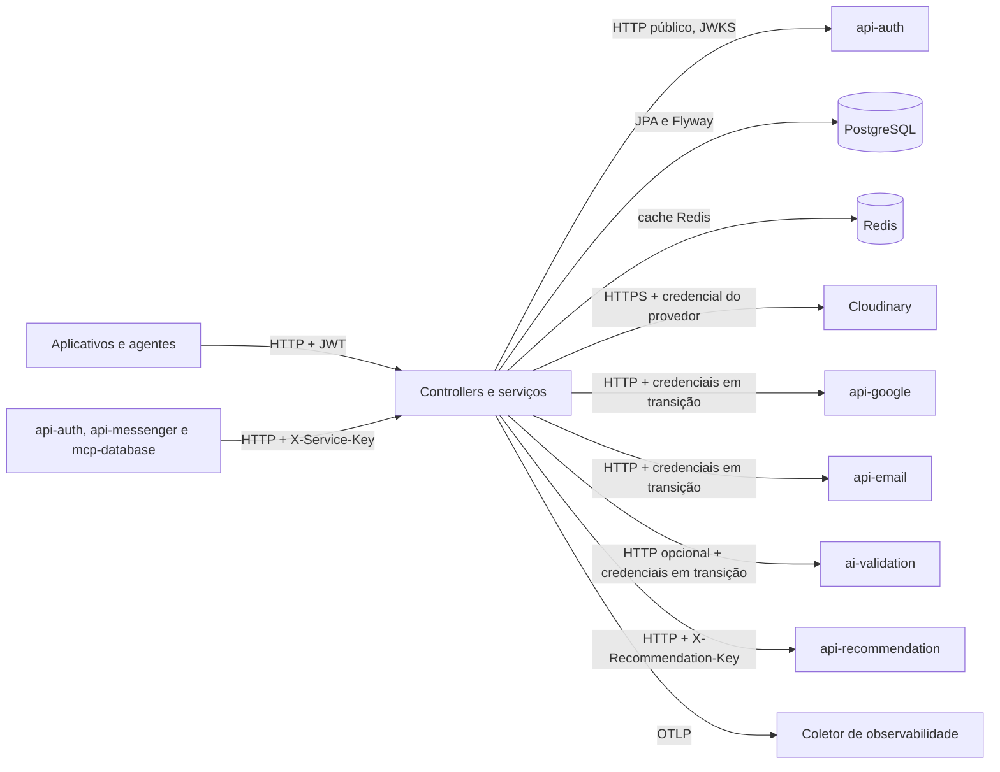

  

# Arquitetura

O serviço usa Java 21, Spring Boot 4.1.2, JPA e PostgreSQL. Os pacotes são organizados por domínio dentro das camadas de controller, service, repository, DTO e entidade. O código da main inclui o DDL do banco em migrations Flyway e tarefas duráveis para tradução, validação profissional e envio de convites.

## Organização

As camadas e os domínios ficam em um único artefato Maven.

| Caminho a partir do pacote Java principal | Papel |
|---|---|
| `controller/`, `openapi/` | entradas HTTP e documentação das operações |
| `service/` | regras, transações, autorização de recursos e tarefas |
| `repository/` | consultas, locks e acesso JPA |
| `domain/entity/`, `domain/enums/` | modelo persistido e estados |
| `dto/` | contratos de entrada, saída e atualizações parciais |
| `security/`, `security/rbac/`, `security/mobile/` | identidade, chaves, permissões e acesso mobile |
| `integration/`, `config/` | clientes HTTP e configuração dos provedores |
| `exception/handler/` | ProblemDetail e tratamento de erros |
| `observability/` | Actuator, traces, logs e correlação |

Os grupos de domínio incluem identidade, empresa, catálogo, unidade, proposta, execução, profissional, pedido e recomendação. `src/main/resources/db/migration/` contém o schema e os dados de referência. Os testes e a coleção Bruno acompanham os grupos de recursos.

## Segurança

Há três cadeias stateless. A chain de ordem zero libera health e info do Actuator. A de ordem um cobre `/internal/**` com `ServiceKeyAuthFilter`. A chain de usuário valida JWT por JWKS e emissor, recusa tipo de token incompatível e libera os catálogos públicos e o atalho provisório de login.

| Consumidor interno | Escopo autorizado |
|---|---|
| `api-auth` | `/internal/users` e seus recursos |
| `api-messenger` | `/internal/projects/**` e `/internal/technical-projects/**` |
| `mcp-database` | leitura de `/internal/catalog/**` |

As chaves vêm de `SERVICE_KEY_API_AUTH`, `SERVICE_KEY_API_MESSENGER` e `SERVICE_KEY_MCP_DATABASE`. Uma chave curta impede a partida, e chave ausente não autentica. A guarda compara as chaves em tempo constante. A exceção de acesso da chain interna ainda usa o entrypoint de autenticação, portanto uma chave válida fora de seu escopo pode ser apresentada como 401 em vez do 403 normativo.

Nas rotas de usuário, o interceptor RBAC combina o identificador da operação com o cargo e suas permissões. Os serviços também conferem empresa, propriedade ou participação. O contexto da requisição reaproveita consultas de identidade e autorização. A resolução atual usa um vínculo empresarial, coerente com a restrição única do banco e diferente da decisão de produto de vários vínculos.

## Integrações

Os aplicativos e agentes usam o JWT da pessoa nas rotas de negócio. Os consumidores internos usam a chave de seu serviço. O catálogo de integrações está em [INTEGRATIONS.md](https://github.com/Solierrr/docs-warehouse/blob/main/docs/flows/INTEGRATIONS.md), com diferenças atuais registradas em [STATUS.md](./STATUS.md).

| Destino | Protocolo e identidade | Uso |
|---|---|---|
| `api-auth` | HTTP, JWKS público e proxy de login | validação de token e atalho `/dev/login` |
| `api-email` | HTTP, `X-API-Key` e `X-Service-Key` quando configurado | envio assíncrono de convites persistidos |
| `api-google` | HTTP, Bearer legado e `X-Service-Key` | tradução de ofertas |
| `ai-validation` | HTTP, Bearer legado e `X-Service-Key` | processamento opcional de documentos |
| `api-recommendation` | HTTP, `X-Recommendation-Key` | feeds com cache em memória e fallback SQL |
| Cloudinary | HTTPS com conta do provedor | imagens públicas e documentos autenticados |

`SERVICE_KEY` é a chave própria enviada a e-mail, tradução e validação. Os clientes ainda têm condições que dependem das credenciais legadas antes de executar. A presença da chave nova não conclui a migração. `/dev/login` também permanece público, sem perfil que o restrinja a desenvolvimento.

## Dados e transações

O [PostgreSQL](../database/POSTGRES.md) é a fonte de negócio, com o Flyway aplicando V1 a V3 na partida e o Hibernate validando as entidades. A V1 inclui 68 tabelas, constraints, índices, triggers e a procedure de cobrança, a V2 cria as views de exportação com seleção de campos e a V3 inclui permissões, cargo administrativo e plano de referência. Os consumidores do schema anterior acompanham esta versão.

O aceite de proposta bloqueia a proposta e o estoque, reserva quantidades e grava `ACCEPTED` na mesma transação. O projeto e o serviço são criados por outras operações. Não há vínculo de proposta no schema do projeto que represente conversão automática.

O checkout bloqueia ofertas em ordem estável, grava snapshots de itens e pagamento e limpa o carrinho na transação. Cancelar pedido pago devolve disponibilidade e marca o pagamento como reembolsado. As regras de compra também têm proteção por triggers no banco.

O [Redis](../database/REDIS.md) guarda somente buscas elegíveis de fornecedores e contadores de popularidade. A indisponibilidade é tratada com retorno ao acesso relacional. O cache do feed de recomendações é separado, em memória do processo, limitado a 256 entradas e com TTL configurável.

## Tarefas duráveis e arquivos

Traduções usam `offer_translation_job`, com versão da origem, lease e token de posse. O worker chama o tradutor fora da transação de claim e confere a versão antes de concluir. Falhas recebem backoff e limite de tentativas.

O onboarding profissional guarda rascunho, snapshot, política e evidências, e a aprovação promove a versão e atualiza o técnico. A validação automática vem desativada por padrão e depende da rota profissional do serviço de validação, ainda por implementar.

Os arquivos não ficam num único armazenamento. As fotos públicas de cadastros e as faturas vão para o Cloudinary, as fotos de projeto ficam em `project_photo.content` e os documentos profissionais começam no PostgreSQL, podendo ser arquivados no Cloudinary autenticado depois de validados, com conferência de SHA-256 na leitura, como detalha o [fluxo de arquivos](../flows/MEDIA_UPLOAD.md).

## Health, versão e observabilidade

Liveness verifica o processo, readiness verifica PostgreSQL e Redis fica fora do health. A chain específica do Actuator libera as sondas. `pom.xml` fornece a versão do OpenAPI e de `/actuator/info`. A versão dos recursos de telemetria também pode vir de configuração de ambiente.

O Micrometer e o OpenTelemetry exportam métricas, traces e logs por OTLP, o `TraceIdResponseFilter` expõe o `X-Trace-Id` e o `ProblemDetailFactory` acrescenta o trace válido ao erro, enquanto as operações no Cloudinary têm observações próprias.

A análise usa a main em [`8469e06c`](https://github.com/Solierrr/api-core/commit/8469e06cddef66b77a00f922863b84c40dd53405), conferida em 2026-10-30.
