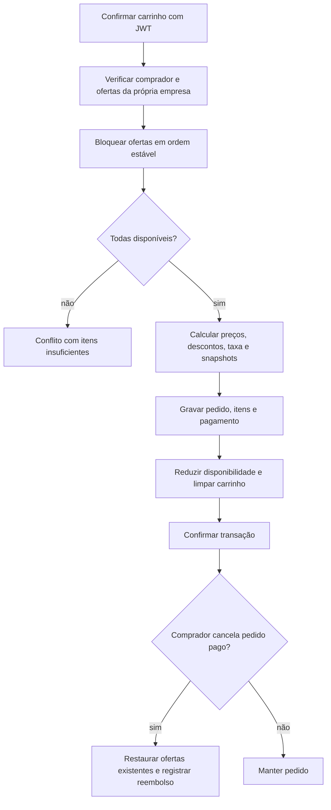

  

# Compra e cancelamento

O comprador confirma o carrinho. O serviço verifica elegibilidade e disponibilidade, registra o pedido e o pagamento e reduz o saldo das ofertas na transação. O cancelamento de pedido próprio pago restaura o saldo das ofertas ainda existentes.

Os totais são calculados pelo servidor. Os itens do pedido preservam nome, fornecedor, preço, desconto e quantidade da compra, mesmo que dados do catálogo mudem. O pagamento é um registro de transação no domínio. O código deste caminho não chama um gateway de pagamento externo.

## Casos de erro

- Carrinho vazio não gera pedido.
- Comprador inelegível ou oferta da própria empresa é recusado.
- Oferta indisponível ou sem saldo provoca `INSUFFICIENT_STOCK`, com detalhes dos itens.
- Pedido de outra pessoa não pode ser consultado ou cancelado por esse caminho.
- Somente pedido pago pode ser cancelado.
- Erro na transação desfaz os registros e a redução de disponibilidade daquela operação.

O modelo de snapshots e suas constraints estão em [POSTGRES.md](../database/POSTGRES.md). O aceite de proposta tem outro fluxo de reserva, descrito em [PROPOSAL_TO_PROJECT.md](./PROPOSAL_TO_PROJECT.md).
