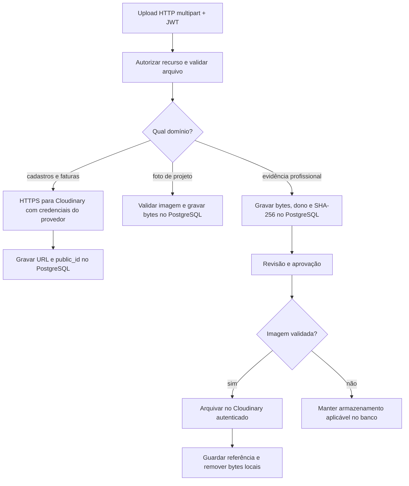

  

# Arquivos e fotos

As operações de upload recebem o arquivo e conferem identidade, acesso ao recurso e limites do domínio. O armazenamento varia conforme o recurso. Nem toda foto nem todo documento é enviado ao Cloudinary.

Fotos de projeto aceitam JPEG e PNG, até 8 MiB, com limite de trinta fotos por projeto. O conteúdo é lido por rota autenticada, com `private, no-store` e proteção de tipo de conteúdo. A foto principal tem unicidade no banco.

Evidências profissionais aceitam os formatos do contrato de documentos, até 10 MiB, com dono e hash. Na leitura de evidência arquivada, o serviço usa acesso autenticado e confere o SHA-256. Fotos de fatura aceitam JPEG, PNG e PDF até 10 MiB. O limite global multipart também é de 10 MB, e cada domínio pode aplicar limite menor.

O helper de Cloudinary oferece limpeza em rollback e exclusão depois de commit. Assets compartilhados do catálogo de demonstração são preservados pelo caminho de exclusão pública. A operação do domínio determina quando esses helpers são usados.

## Casos de erro

- Recurso de outra pessoa ou empresa não pode ser alterado sem acesso.
- Arquivo vazio, tipo incompatível, limite de tamanho ou quantidade excedido impede o upload.
- Imagem de projeto inválida não é aceita apenas pelo MIME declarado.
- Falha do provedor gera erro de armazenamento.
- Documento com hash diferente ou conteúdo indisponível não é entregue como evidência válida.

O processo de aprovação está em [PROFESSIONAL_VALIDATION.md](./PROFESSIONAL_VALIDATION.md), e os campos persistidos estão em [POSTGRES.md](../database/POSTGRES.md).
