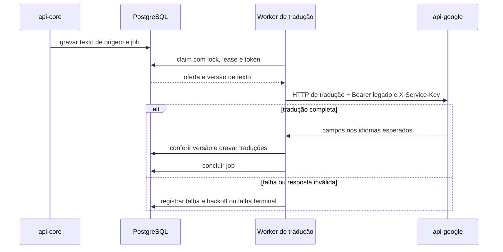

  

# Tradução de ofertas

Ao gravar uma versão do texto da oferta, o serviço agenda um trabalho no PostgreSQL. O worker traduz os campos e só aplica o resultado se a versão de origem ainda é a mesma. O processo persiste as tentativas para sobreviver a reinícios.

O texto de origem pendente usa locale `und`. O resultado deve cobrir português, inglês e espanhol com todos os campos solicitados. A aplicação confere oferta e identificador da versão antes de promover as traduções. Trabalho de uma versão antiga pode ser cancelado sem substituir o texto atual.

O worker consulta a fila a cada cinco segundos por padrão, trata até cinco itens por ciclo e tem cinco tentativas por padrão. O lease padrão é de cinco minutos. A posse é conferida pelo token de claim antes de finalizar. Esses limites são configuráveis pelas propriedades do worker.

## Casos de erro

- Credencial legada ausente impede a chamada, mesmo com chave de serviço configurada.
- Resposta sem idiomas ou campos completos é recusada.
- Oferta excluída ou versão substituída cancela o trabalho incompatível.
- Falha externa agenda nova tentativa com backoff, até o limite configurado.
- Uma falha ao finalizar estado terminal mantém o trabalho para nova tentativa de finalização.

O consumidor HTTP está em `GoogleTranslateService`, e o controle durável fica em [POSTGRES.md](../database/POSTGRES.md). Essa fila não usa o cache Redis.
