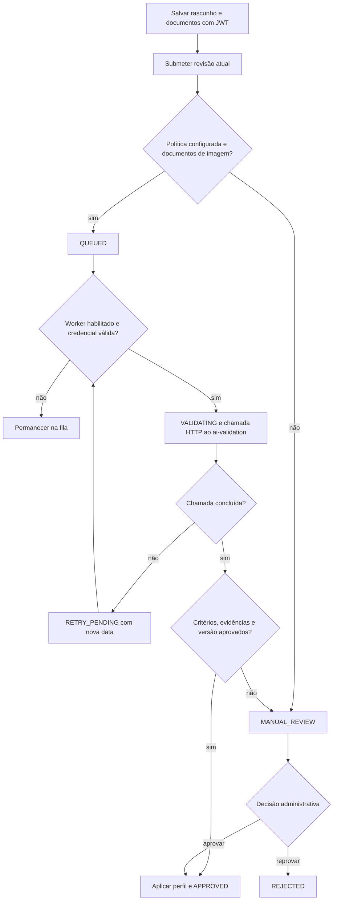

  

# Aprovação profissional

A pessoa envia os documentos e uma versão do seu cadastro, e a submissão guarda uma cópia do rascunho e da política da profissão. O perfil aprovado só é promovido depois de uma decisão válida, e o processamento automático depende da integração de validação.

O upload admite categorias de evidência conhecidas, até 10 MiB por documento e até trinta documentos por pessoa em um dia. A submissão aceita até dez documentos, todos da própria pessoa e cobrindo os requisitos da profissão. Rascunho com submissão aguardando decisão não pode ser livremente substituído.

O worker espera `/api/v1/professionals/validate`, envia Bearer de serviço e `X-Service-Key` quando configurado. Confere identificador de submissão, revisão, política, resultado dos critérios e referências de evidência. Uma resposta aprovada só promove a versão se a base aprovada ainda coincide. Caso contrário, segue para revisão manual.

Na aprovação, o serviço atualiza a pessoa, o contato, o técnico e o registro profissional, e as imagens validadas podem ser arquivadas num armazenamento autenticado. O catálogo público só mostra técnicos com o estado aprovado.

## Casos de erro

- Revisão desatualizada ou decisão sobre versão já alterada recebe conflito.
- Documento alheio, identidade inválida ou evidência obrigatória ausente impede a submissão.
- Política incompleta ou documento fora do caminho de imagem gera revisão manual.
- Integração indisponível agenda nova tentativa, sem promover o perfil.
- Resposta com evidências ou critérios incompatíveis não é aceita como aprovação automática.
- Worker desligado não processa automaticamente os itens que ficaram em fila.
