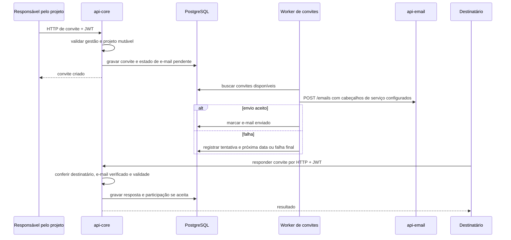

  

# Convite de projeto

Um proprietário ou gestor convida uma pessoa ou integrantes de uma equipe para o projeto. O convite é gravado antes do envio do e-mail. A resposta do destinatário e o estado do envio são controles separados.

O convite não transfere a propriedade do projeto e admite os papéis de gestor, participante e observador, recusando um segundo convite pendente para o mesmo destinatário. A aceitação exige que a identidade ou o e-mail correspondam ao convite e que a sessão traga a claim de e-mail verificado.

O worker faz até cinco tentativas, com espera crescente limitada a uma hora. Ele ainda depende da configuração legada de chave para iniciar, embora envie a chave de serviço quando disponível. O reenvio de um convite pendente renova a validade e reinicia o controle de tentativas.

## Casos de erro

- Pessoa sem papel de gestão, projeto indisponível ou destino incompatível impede o convite.
- Equipe inativa ou integrante sem contato válido impede criar os convites daquela solicitação.
- Convite expirado, já respondido ou conta sem e-mail verificado não pode ser aceito.
- Falha no transporte de e-mail não desfaz a criação do convite.

O percurso entre serviços está em [PROJECT_INVITE_EMAIL.md](https://github.com/Solierrr/docs-warehouse/blob/main/docs/flows/PROJECT_INVITE_EMAIL.md). O acesso da comunidade está em [PROJECT_COMMUNITY.md](https://github.com/Solierrr/docs-warehouse/blob/main/docs/flows/PROJECT_COMMUNITY.md).
