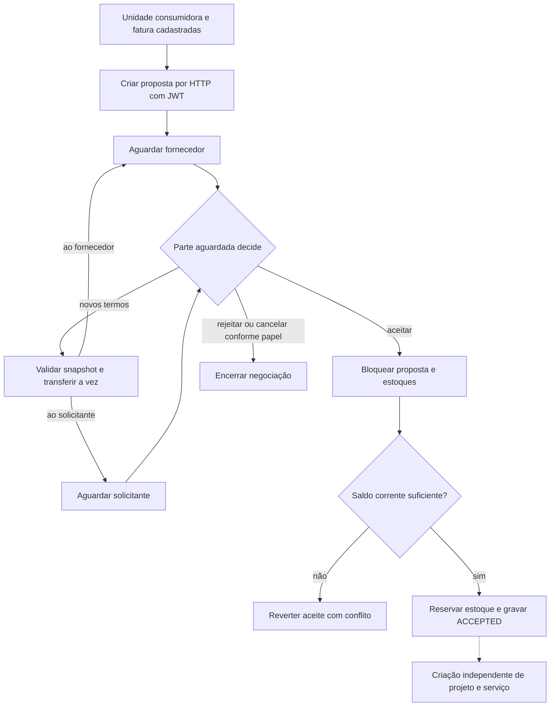

  

# Negociação e passagem ao projeto

O solicitante cria uma proposta com fornecedor e itens completos. As partes alternam a vez de responder aos termos. O aceite bloqueia os saldos e reserva estoque, mas não cria projeto automaticamente. A passagem para projeto e execução permanece uma etapa separada da implementação.

A unidade e a fatura representam o ponto de partida do fluxo de produto. A criação comercial atual deriva o solicitante da empresa e não valida uma fatura como pré-requisito.

Os itens são da mesma fornecedora da proposta. Quantidade e preço são positivos, e desconto fica entre zero e cem. A criação confere disponibilidade, mas não reserva saldo. Os termos substituem o conjunto comercial, preservam a identidade dos itens mantidos e podem remover alocações dos itens omitidos.

O aceite agrupa quantidades por modelo, bloqueia os estoques em ordem estável e atualiza a disponibilidade corrente das ofertas na transação. Um conflito desfaz a reserva inteira. O fornecedor pode rejeitar uma negociação pendente, e o solicitante pode cancelá-la. Estados terminais não voltam à negociação por essas operações.

## Casos de erro

- Não participante não recebe acesso à proposta.
- Parte fora da vez ou proposta terminal recebe conflito.
- Oferta de outra fornecedora, preço inválido ou quantidade não positiva é recusada.
- A quantidade de um item mantido não pode ficar abaixo da soma já alocada às unidades.
- Falta de estoque ou mudança de disponibilidade impede o aceite.

O percurso técnico após a criação independente está em [SERVICE_EXECUTION.md](./SERVICE_EXECUTION.md). O diagrama não representa conversão automática entre proposta e projeto.
