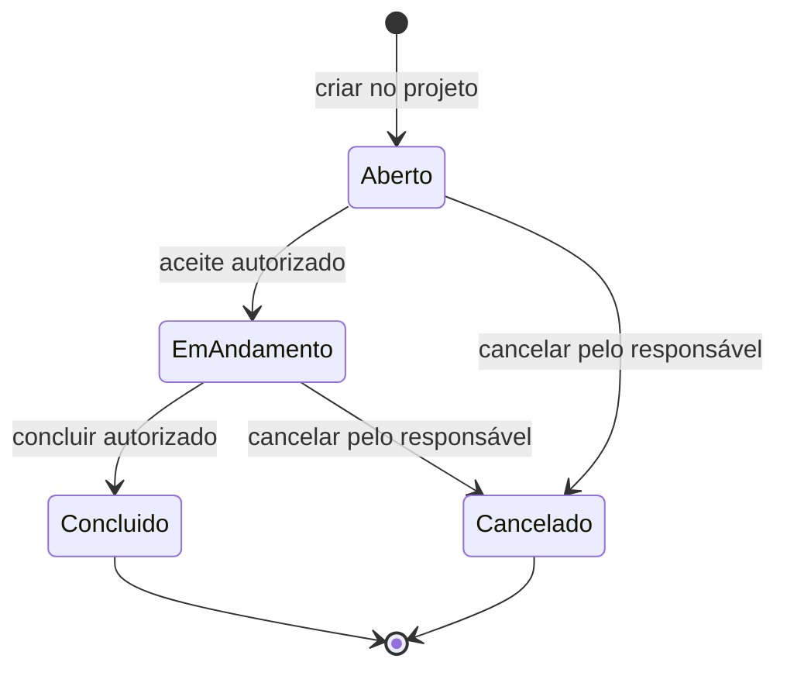

  

# Execução do serviço técnico

O serviço técnico é criado dentro de um projeto. A aceitação usa a identidade da sessão e as regras de acesso mobile ou de solicitante. O contrato é uma operação própria, permitida quando o serviço já está em andamento.

O propósito só é alterado enquanto o serviço está aberto. O reagendamento admite serviço aberto ou em andamento. O aceite grava autor e data da sessão e exige a transição de aberto para andamento. Quando o aceite é feito no modo de solicitante, deve haver ao menos um executor.

Cada serviço admite um contrato. A criação do contrato exige estado em andamento, valida o prazo de entrega e inicia a aprovação da concessionária como pendente. A conclusão grava a data de término. A criação consulta o serviço referenciado, e a autorização de rota passa pelo controle de acesso.

## Casos de erro

- Projeto ou serviço fora do escopo da pessoa não pode ser administrado.
- Aceite repetido ou conclusão antes do andamento viola a transição esperada.
- Finalidade de serviço já iniciado não pode ser alterada pelo caminho de atualização de propósito.
- Contrato duplicado, serviço fora de andamento ou prazo passado impede a criação do contrato.

O serviço de conversas consulta a participação do projeto pelo [fluxo de comunidade](https://github.com/Solierrr/docs-warehouse/blob/main/docs/flows/PROJECT_COMMUNITY.md). Esse acesso não substitui a autorização das operações de execução.
